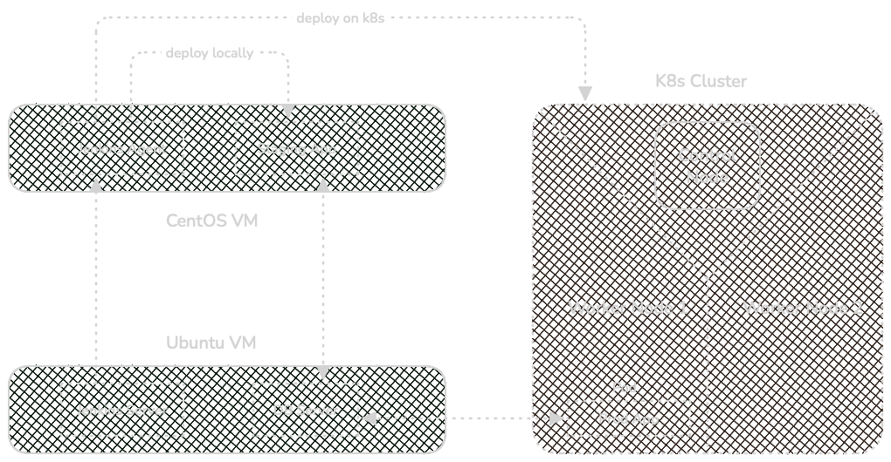
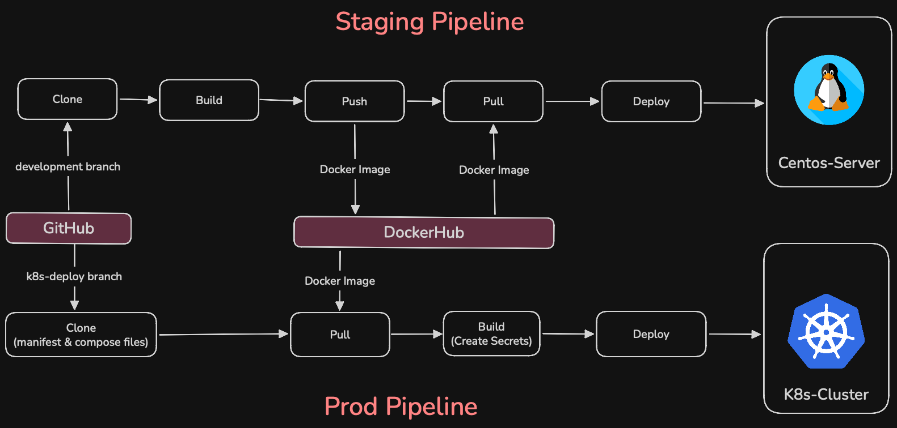
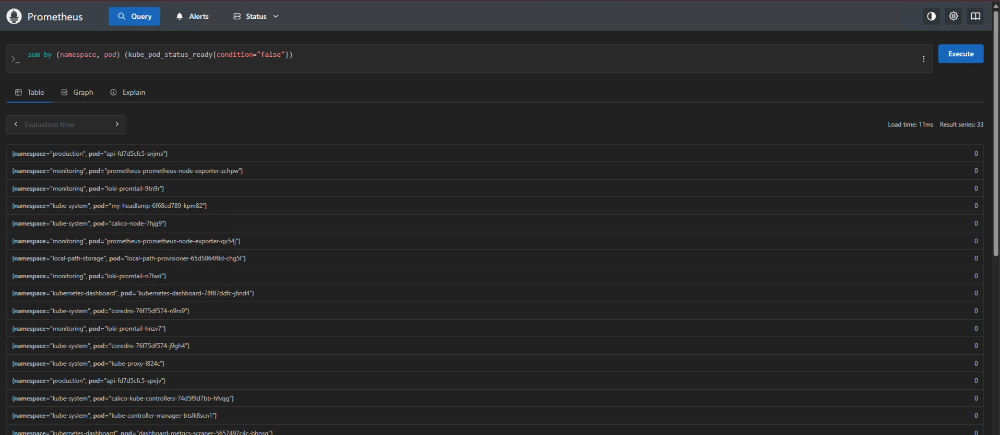
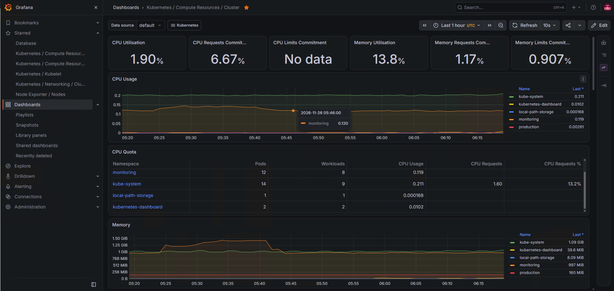
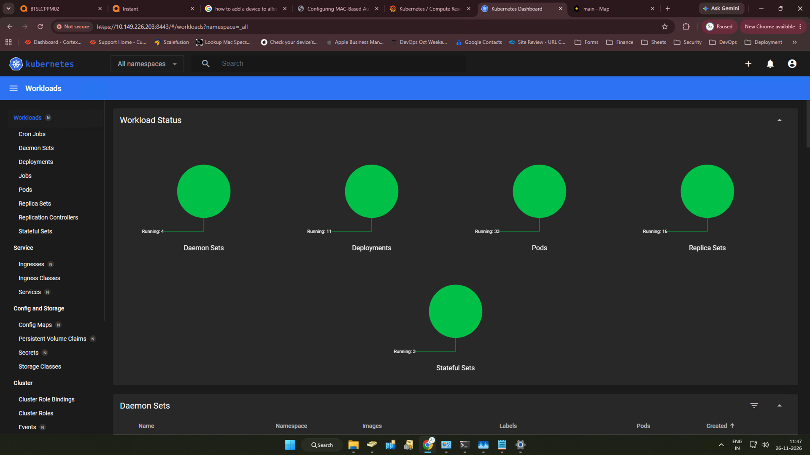
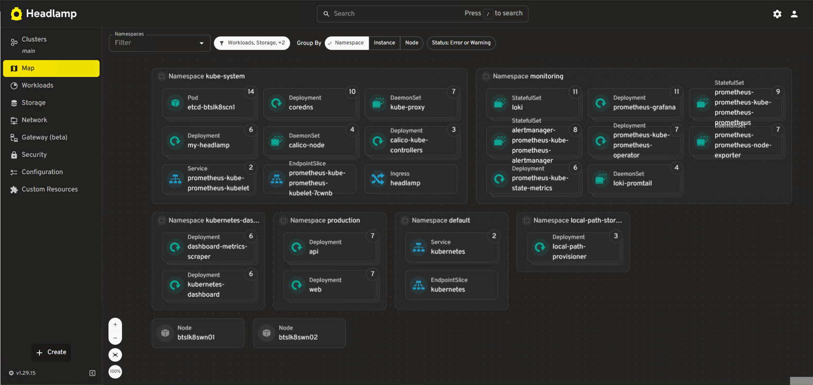

# Get It Done – A DevOps Project

A task management web application used to demonstrate DevOps practices through separate **Staging** and **Production** environments, Jenkins-based CI/CD, Docker containers, Kubernetes, and monitoring tools.

> **Project note:** This is a DevOps capstone project built to demonstrate practical skills. The application is deployed in the project infrastructure, but a public demo URL is not currently provided.
> 

---

## Table of Contents

- Project Overview
- Architecture Overview
- Infrastructure Architecture
- Technology Stack
- Deployment Environments
- CI/CD Pipeline
- Monitoring and Cluster Management
- Project Status
- Future Improvements

---

## Project Overview

**Get It Done** is a task management web application with two deployment environments:

- **Staging:** The application runs in Docker containers on a static Linux server.
- **Production:** The application runs in Docker containers on a Kubernetes cluster.

Jenkins is used to create CI/CD pipelines and automate application deployment. Prometheus and Grafana are set up for infrastructure monitoring. Kubernetes Dashboard and Headlamp are available for viewing and managing Kubernetes resources.

The main goal of this project is to practise and demonstrate a DevOps workflow across application deployment, containerization, orchestration, and monitoring.

## Architecture Overview

The project uses different deployment platforms for Staging and Production.

| Component | Staging Environment | Production Environment |
| --- | --- | --- |
| Hosting platform | Static Linux server | Kubernetes cluster |
| Application packaging | Docker container | Docker container |
| Deployment automation | Jenkins CI/CD | Jenkins CI/CD |
| Main purpose | Testing and validation | Production deployment |
| Infrastructure | Single Linux server | One control-plane node and two worker nodes |

## Infrastructure Architecture

The project infrastructure includes a Jenkins server, a Linux server for Staging, and a Kubernetes cluster for Production. Monitoring and cluster-management tools are also part of the setup.

### Infrastructure Diagram

### Infrastructure Details

| Name | Hostname | Private IP | Role |
| --- | --- | --- | --- |
| Jenkins Server | — | `10.149.226.208` | Runs Jenkins CI/CD |
| CentOS Local VM | — | `10.149.226.205` | Local Linux virtual machine |
| Kubernetes Control Plane | `BTSLK8SCN1` | `10.149.226.203` | Kubernetes control-plane node |
| Kubernetes Worker 1 | `BTSLK8SWN01` | `10.149.226.27` | Kubernetes worker node |
| Kubernetes Worker 2 | `BTSLK8SWN02` | `10.149.226.28` | Kubernetes worker node |

> **Security note:** The IP addresses above are private network addresses. Review this table before publishing the repository publicly. Remove internal IP addresses, hostnames, usernames, login URLs, credentials, tokens, and other sensitive details if the repository or documentation will be public.
> 

## Technology Stack

| Area | Technology | Purpose |
| --- | --- | --- |
| CI/CD | Jenkins | Automates application build and deployment |
| Containerization | Docker | Packages and runs the application in containers |
| Container orchestration | Kubernetes | Runs the Production application |
| Operating system | Linux / CentOS | Hosts project services and the Staging application |
| Monitoring | Prometheus | Collects monitoring metrics |
| Visualization | Grafana | Displays monitoring data in dashboards |
| Kubernetes management | Kubernetes Dashboard | Provides a web interface for cluster resources |
| Kubernetes management | Headlamp | Provides a web interface for Kubernetes cluster management |

## Deployment Environments

### 1. Staging

- Hosted on a static Linux server.
- Application runs inside Docker containers.
- Jenkins is used for the deployment workflow.
- Used as the Staging environment before Production.

### 2. Production

- Hosted on a Kubernetes cluster.
- The cluster has one control-plane node and two worker nodes.
- The application runs in Docker containers managed by Kubernetes.
- Jenkins is used for the deployment workflow.

## CI/CD Pipeline

Jenkins is used to automate the application deployment process for the Staging and Production environments.

## Monitoring and Cluster Management

The project includes the following tools:

| Tool | Use |
| --- | --- |
| Prometheus | Collects infrastructure and system metrics |
| Grafana | Displays metrics through dashboards |
| Kubernetes Dashboard | Web-based view of Kubernetes resources |
| Headlamp | Web-based Kubernetes cluster management |

## Project Status

| Feature | Status |
| --- | --- |
| Staging environment on a static Linux server | Deployed |
| Docker-based application deployment | Deployed |
| Jenkins CI/CD setup | Configured |
| Production deployment on Kubernetes | Deployed |
| Kubernetes cluster with one control-plane and two worker nodes | Set up |
| Prometheus and Grafana setup | Set up |
| High Availability configuration | Planned |

## Future Improvements

- Configure and test High Availability for the Production application.
- Improve monitoring for Kubernetes workloads and application performance.
- Add more deployment and recovery checks to the CI/CD workflow, where required.
- Add screenshots and architecture diagrams to this README.

---

